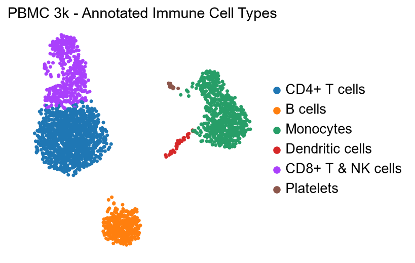

# Single-Cell RNA-seq Analysis of Human PBMC (3k)

An end-to-end single-cell transcriptomics pipeline built with Python and **Scanpy** to process, cluster, and annotate human Peripheral Blood Mononuclear Cells (PBMCs) from 10x Genomics.



## 1. Project Overview
Single-cell RNA sequencing (scRNA-seq) enables the dissection of cellular heterogeneity at single-cell resolution. This project demonstrates a standard bioinformatics workflow—from raw UMI count matrices to biologically interpretable immune cell populations—using the benchmark **10x Genomics PBMC 3k** dataset.

## 2. Dataset
* **Source:** 10x Genomics (`sc.datasets.pbmc3k()`)
* **Raw Dimensions:** 2,700 cells × 32,738 genes
* **Format:** Sparse matrix stored in `AnnData` (`.h5ad`)

## 3. Analysis Pipeline
1. **Quality Control (QC) & Filtering:**
   * Computed per-cell QC metrics (`n_genes_by_counts`, `total_counts`, `pct_counts_mt`).
   * Filtered out empty droplets (`min_genes=200`), low-abundance genes (`min_cells=3`), potential doublets (`n_genes_by_counts < 2500`), and dying/damaged cells (`pct_counts_mt < 5%`).
   * **Post-QC Dimensions:** 2,638 high-quality cells × 13,714 genes.
2. **Normalization & Feature Selection:**
   * Library-size normalization to 10,000 counts per cell (`normalize_total`) followed by $\log(x + 1)$ transformation (`log1p`).
   * Identified Highly Variable Genes (HVGs) to retain biologically informative variation while preserving the full transcriptome in `adata.raw`.
3. **Dimensionality Reduction:**
   * Regressed out technical confounders (`total_counts`, `pct_counts_mt`) and scaled features (`max_value=10`).
   * Applied PCA (`n_pcs=40`) to denoise the expression space, constructed a k-Nearest Neighbors (k-NN) graph (`n_neighbors=10`), and projected cells into 2D using **UMAP**.
4. **Graph-Based Clustering & Differential Expression:**
   * Partitioned cells into 6 distinct clusters using the **Leiden** algorithm (`resolution=0.5`, `flavor="igraph"`).
   * Performed Wilcoxon rank-sum tests (`rank_genes_groups`) to identify cluster-specific marker genes.

## 4. Cell Type Annotation
Clusters were manually annotated by cross-referencing statistically enriched genes with canonical immune marker genes:

| Leiden Cluster | Annotated Cell Type | Canonical Marker Genes |
| :--- | :--- | :--- |
| **0** | CD4+ T cells | `IL7R`, `CD3D` |
| **1** | B cells | `MS4A1`, `CD79A` |
| **2** | Monocytes | `CD14`, `LYZ`, `CST3` |
| **3** | Dendritic cells | `FCER1A`, `CST3` |
| **4** | CD8+ T & NK cells | `NKG7`, `GNLY`, `CD8A`, `CD8B` |
| **5** | Platelets | `PPBP`, `PF4` |

## 5. Repository Structure
```text
├── data/
│   └── pbmc3k_annotated.h5ad      # Processed & annotated AnnData object
├── figures/
│   └── umap_pbmc3k_annotated.png  # Final UMAP visualization
├── notebooks/
│   └── pbmc3k_pipeline.ipynb      # Full analysis notebook
├── requirements.txt               # Python dependencies
└── README.md